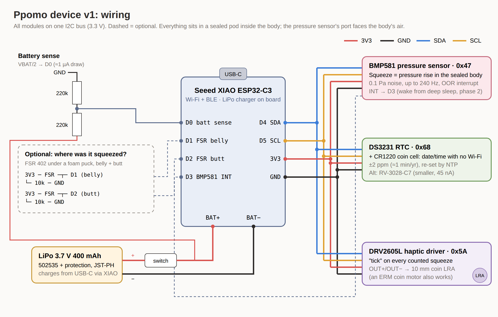

# Ppomo — device design for review

**Goal:** a palm-sized squishy toy (Ppomo) that counts every squeeze ("one squeeze = one event"), stamps each one with date and time, and shows them on a web page. The digital Ppomo character inflates with the count.

This is the design I'd build if cost and my current skill weren't limits. It is written for review: please mark what you'd change, swap or simplify. My open questions are at the end.



## 1. Requirements

| # | Requirement | How this design meets it |
|---|---|---|
| R1 | Count every squeeze exactly once: quick, slow, long-hold, rapid (4/s) | Pressure sensor + hysteresis detector, tested on 11 synthetic cases (§5) |
| R2 | Squeeze anywhere on the body, not on one spot | Measure the **air pressure inside the sealed body**, which rises wherever you squeeze |
| R3 | Nothing hard or wearing out at the surface | Sensor sits in a pod in the middle; no flex sensor bending thousands of times |
| R4 | Date + time on each squeeze, even offline | DS3231 RTC sets the clock at boot; NTP corrects it whenever Wi-Fi is up; events are logged to flash first |
| R5 | Events reach a web page | Wi-Fi → HTTPS POST to a Supabase table → static dashboard |
| R6 | No lost or double events | Every event has a sequence number; the server ignores duplicates; the device only forgets what the server has acknowledged |
| R7 | Feedback in the hand | Haptic "tick" (DRV2605L + coin LRA) on each counted squeeze |
| R8 | Fits inside the 95 mm sitting Ppomo | Cavity ≈ 72 × 86 × 77 mm; bottom opening Ø30 mm |
| R9 | Battery, rechargeable | 400 mAh LiPo, charged through the XIAO's USB-C |

## 2. System

```
 hand ──squeeze──▶ sealed rubber body (air) ──▶ BMP581 pressure ──I2C──▶ XIAO ESP32-C3
                                                                          │  sensor task 100 Hz → detector
                                    DS3231 RTC ◀──I2C──▶ (date/time)      │  haptic tick (DRV2605L → LRA)
                                                                          │  flash log (LittleFS, seq numbers)
                                                                          ▼  every 60 s if unsent:
                                     Wi-Fi on → NTP (also sets RTC) → HTTPS POST → Wi-Fi off
                                                                          ▼
                                     Supabase table `squeezes(device_id, seq, ts, source, peak_pa)`
                                                                          ▼
                                     web dashboard (today / 14 days / by hour / recent) + Ppomo character
```

### Why air pressure, not flex or FSR

| Option | For | Against |
|---|---|---|
| **Pressure in the sealed body (chosen)** | Senses a squeeze anywhere; one sensor; nothing at the surface to wear; also gives strength (Pa) | Body must be fairly airtight (time constant ≳ 10 s, see §5); weather and hand warmth drift (handled in software) |
| FSR 402 under foam pucks | Says *where* (belly / butt) | Only senses its own spot; needs a foam load-spreader; drifts and creeps under constant load |
| Flex sensor (what the school has) | Cheap, easy to test now | Senses bending of one strip only; the tab end breaks with repeated bending; output depends on how it's glued |
| Velostat / conductive foam | Cheap, any shape | Noisy, drifts with humidity and age |
| Capacitive | No moving parts | Detects touch, not squeeze; affected by hand holding it |

So the plan is **pressure for counting**, with **optional FSRs only to tell belly from butt** (the character's belly and butt inflate separately).

If the printed rubber body leaks too much, the fallback is the same sensor inside a small **sealed silicone air bladder** (a bulb, or a balloon around the pod) that the body squeezes.

## 3. Bill of materials (v1, built from dev boards)

Prices are rough, to be checked.

| # | Part | Why | Qty | ≈ USD |
|---|---|---|---|---|
| 1 | Seeed Studio **XIAO ESP32-C3** | Wi-Fi + BLE, tiny (21 × 17.5 mm), built-in LiPo charger | 1 | 5 |
| 2 | **BMP581** pressure breakout (SparkFun Qwiic BMP581) | The squeeze sensor. 0.1 Pa noise, fast, has a pressure-window interrupt to wake the MCU | 1 | 20 |
| 3 | **DS3231** RTC breakout (Adafruit, STEMMA QT) + **CR1220** cell | Keeps date/time through reboots and offline | 1 | 14 |
| 4 | **DRV2605L** haptic driver (Adafruit) | Crisp, repeatable "tick" effects, I2C | 1 | 8 |
| 5 | **10 mm coin LRA** (e.g. Precision Microdrives C10-100), or an ERM coin motor | Haptic feedback | 1 | 3–8 |
| 6 | **LiPo 3.7 V 400 mAh** (502535) with protection board, JST-PH 2.0 | Power | 1 | 7 |
| 7 | Mini slide switch | Battery off for shipping / storage | 1 | 1 |
| 8 | 220 kΩ resistor | Battery voltage divider → D0 | 2 | — |
| 9 | Qwiic / STEMMA QT cables 50 mm, or 30 AWG silicone wire | I2C bus | 3 | 3 |
| 10 | 3D-printed **core pod** (PETG or resin) + silicone plug for the bottom hole | Holds everything; sensor port open to the body's air | 1 | — |
| 11 | **Rubber body**: sitting Ppomo, 95 mm, 2.5 mm wall (TPU 85A or silicone-like resin) | The toy. `characters/ppomo-cat/ppomo-sit-shell-95mm.stl` | 1 | print shop |
| — | *Optional:* FSR 402 + 10 kΩ + foam puck | Belly / butt location | 2 | 7 each |
| — | *Optional:* Qi receiver 5 V | Charge without opening the toy | 1 | 8 |

**v2 (later):** one small round PCB (≈ Ø28 mm) with ESP32-C3 module, BMP581, RV-3028 RTC, DRV2605L and charger, so the pod shrinks to fit through the Ø30 mm hole without stretching it.

## 4. Wiring

See `wiring.svg` / `wiring.png`.

| XIAO pin | Goes to |
|---|---|
| D4 (SDA), D5 (SCL), 3V3, GND | I2C bus: BMP581 (0x47), DS3231 (0x68), DRV2605L (0x5A). No address clashes |
| D3 | BMP581 INT (for deep-sleep wake in phase 2; not used by v1 firmware) |
| D0 | Battery sense: VBAT – 220k – D0 – 220k – GND |
| D1, D2 | Optional FSRs: 3V3 – FSR – pin – 10k – GND |
| BAT+ / BAT− pads | LiPo through the slide switch |
| DRV2605L OUT+ / OUT− | LRA motor |

## 5. Firmware (`firmware/ppomo-device/`)

- `squeeze_detector.h` — the counting rule, plain C++:
  - PRESS 200 Pa held 30 ms → count.
  - It counts again only after the signal stays within RELEASE 80 Pa for 120 ms.
  - The resting value follows slow drift and follows a lower value quickly. A hold longer than 4 s re-arms with no extra count.
- `event_log.h` — append-only flash log. Each record holds seq, UTC ms, uptime, boot number, source and peak Pa. The seq / acked counters live in NVS.
- `ppomo-device.ino`:
  - **Sensor task**: a FreeRTOS task at 100 Hz, so Wi-Fi never delays sensing.
  - **Main loop**: logs each squeeze, prints JSON over USB, and once a minute uploads anything unsent (Wi-Fi on → NTP → POST → Wi-Fi off).
- `config.h` — Wi-Fi, Supabase URL / key, device id.
- **Builds:** compiles for `esp32:esp32:XIAO_ESP32C3` (core 3.3.12, with the SparkFun BMP581, RTClib and Adafruit DRV2605 libraries): 1.18 MB, which is 90% of the default app partition, and 40 KB of RAM. Not yet run on hardware.
- **Host test**: `firmware/test/run.sh` runs the detector on synthetic pressure signals. It passes 11/11 cases:

  | Case | Result |
  |---|---|
  | quick squeeze, slow 2 s squeeze | counted once each |
  | 20 normal squeezes | 20 |
  | rapid 4/s | 8 of 8 |
  | light +300 Pa squeezes | all 5 |
  | 10 s hold in a leaky body, then 3 more | 4 |
  | hand warming +400 Pa, with and without squeezes on top | 0 false counts, all 5 squeezes counted |
  | weather drift | 0 false counts |
  | noise only | 0 false counts |
  | a 20 ms bump | not counted |

  The limit it shows: drift faster than ~40 Pa/s could be miscounted. So the body's air must leak out slowly (time constant ≳ 10 s).

**Time stamping:**
- At boot, the clock comes from the DS3231.
- On each Wi-Fi sync, NTP sets the clock and writes it back to the RTC.
- A squeeze made before the clock was known keeps its uptime. It gets back-dated at upload if the device hasn't rebooted since; otherwise `ts` is null and the server's `received_at` is used.

**Power (estimates, to measure):**
- Awake, sampling at 100 Hz: ≈ 20 mA → ~20 h on 400 mAh. Fine for a show day; charge nightly.
- Phase 2: the BMP581's out-of-range interrupt on D3 wakes the ESP32 from deep sleep on a squeeze. Standby drops to roughly 50–100 µA, i.e. weeks.

## 6. Web (`web/`)

- `schema.sql` — a Supabase table `squeezes`:
  - Primary key `(device_id, seq)`, so a re-sent upload is a no-op.
  - Row-level security: the anon key can only insert and read.
  - A per-day view in New York time.
- `dashboard.html` — a static page with no build step. It shows today, all-time, the last 14 days, today by hour and the recent squeezes with strength, refreshing every 5 s. It shows demo data until a URL / key is entered.
- Upload format (JSON array, one object per squeeze):
  ```json
  [{"device_id":"ppomo-01","seq":12,"ts":"2026-10-18T22:45:43.987Z","source":"body","peak_pa":1840,"boot":3}]
  ```

## 7. Mechanical

- **Body:** the sitting Ppomo is 95 mm tall, 2.5 mm wall and 5 mm flat floor. It has a **Ø30 mm hole** in the floor and a 7 × 3 mm cable groove from the hole to the back, so it sits flat while plugged in. Eyes and mouth keep a full wall behind them.
- **Pod:** goes in through the hole; a rubber body stretches enough for a slightly bigger pod. Its bottom face is the plug that seals the hole (silicone gasket) and exposes the USB-C port.
- **Sensor:** the BMP581's port faces up into the body's air. It is not covered by foam or glue.
- **Airtightness:** check that the printed rubber holds pressure. Squeeze it shut and watch the pressure decay on the serial stream (`S` command).

## 8. Test plan

| Step | What | Pass if |
|---|---|---|
| 1 | Now, school parts: Nano 33 IoT + 2 flex sensors in a stress ball, `ppomo-test-bench` page | Counting rules work by hand; each squeeze gets date + time; CSV export |
| 2 | BMP581 on the bench in a sealed jar or balloon | Squeeze → clear Pa rise; noise < 10 Pa |
| 3 | BMP581 inside the printed rubber body | Firm squeeze ≥ 300 Pa; leak time constant ≥ 10 s |
| 4 | Full v1 in the body, phone hotspot | 100 squeezes → 100 rows on the dashboard with correct times |
| 5 | Offline day: no Wi-Fi for hours, then reconnect | All events arrive once, in order, times correct |
| 6 | Battery | Runs ≥ 10 h awake |

## 9. Questions for Tom

1. Is **air pressure inside the body** a sound primary sensor for a squishy, or would you start with FSRs?
2. Which **rubber print** process is most likely to be airtight at 2.5 mm: FDM TPU 85A, SLA elastic resin, or cast silicone from a printed mold?
3. **Wi-Fi at the Winter Show:** can a device join NYU Wi-Fi (device registration / nyu-legacy), or should I plan on a phone hotspot? Or should I switch to BLE → phone → web?
4. Is the **DS3231** worth the space if the toy syncs NTP often, or should I go straight to a smaller RV-3028?
5. Does ITP have a **BMP280/BME280/BMP390** I could borrow to try step 2 before ordering a BMP581?
6. Haptics: is the **DRV2605L + LRA** worth it over driving an ERM coin motor from a transistor?
7. Anything here you'd cut for a first working version?
