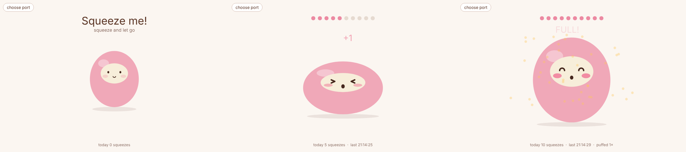

# Ppomo 플레이테스트 (11/24 PComp)

## 무엇을 가져가나
- 고무공(벌브) → 실리콘 호스 → MPRLS → Nano 33 IoT → USB → 노트북(Chrome)
- Arduino 코드는 **squeeze-log 것 그대로** (`../squeeze-log/arduino/ppomo_squeeze_log/`). 바꿀 것 없음.
- 화면은 이 폴더의 `index.html` + `sketch.js` (p5 웹 에디터에 붙여 넣어도 됨).
- 가능하면 프린트한 뽀모 몸이나 컨셉 아트를 벌브 옆에 둬서 "이게 뽀모 몸이 될 거다"를 보여주기.

## 인터랙션 (입력 → 출력)
| 사람이 하는 것 | 화면 뽀모 |
|---|---|
| 쥐는 동안 | 바로 납작해지고 눈이 `> <` (세게 쥘수록 더 납작) |
| 놓으면 | 한 칸 부풀고 `+1`, 소리, 위의 점 하나 채워짐 |
| 10번 | 가득 참: `^ ^` 웃고 반짝이, 3초 뒤 바람 빠지고 새 판 |
| 4초 동안 안 쥐면 | 바람이 새서 한 칸씩 작아짐: "air is leaking… squeeze!" |
| 20초 동안 아무도 안 쥐면 | 처음 화면 "Squeeze me!"로 돌아감 |

모든 쥐기는 날짜·시간과 함께 기록됨 (아래 "today N squeezes · last 시간", S 키로 CSV).

## 4가지 기준에 어떻게 맞나
1. **설명 최소**: 화면에 "Squeeze me!"만 있음. 쥐자마자 뽀모가 찌그러져서 "이걸 쥐면 이게 반응한다"가 바로 보임 (타격 버튼 예시와 같은 구조).
2. **나 말고 다른 사람도**: 가장 세게 쥔 값에 맞춰 화면 반응 크기가 자동으로 맞춰짐. 손힘이 약해도 찌그러짐이 보임. 횟수는 8 hPa만 넘으면 세짐.
3. **내 개입 없이 시작/멈춤/리셋**: 시작 = 쥐면 시작. 멈춤 = 놓으면 바람이 샘. 리셋 = 10번 채우면 새 판, 20초 아무도 없으면 처음 화면. 키보드는 안 건드려도 됨.
4. **반복 루프**: 쥘 때마다 커짐 → 점 10개 목표가 보임 → 멈추면 작아짐 → 다시 쥐게 됨 → 가득 차면 보상 → 다시 처음부터.

## 수업 전 체크 (5분)
1. 보드 연결 → Arduino IDE에서 업로드 (업로드 후 1초 벌브 만지지 않기) → **시리얼 모니터 닫기**
2. Chrome으로 `index.html` 열기 → `choose port` → 보드 선택 (한 번 허락하면 다음엔 자동으로 열림)
3. `D` 키로 압력 그래프 확인: 쥐면 숫자가 올라가는지
4. `F` 전체화면, `R` 기록 지우고 시작
5. 소리 켜기 (첫 키 누르면 소리가 켜짐)

**센서가 안 될 때 백업**: Space를 누르고 있다 떼면 쥐기와 똑같이 동작함. 화면 흐름은 이걸로라도 보여줄 수 있음.

## 테스트할 때 내가 할 일
- 말은 딱 이것만: **"This is Ppomo. Try it."** 그리고 손 떼고 관찰.
- 적어둘 것:
  - 처음 쥐기까지 걸린 시간, 벌브를 어떻게 잡았는지 (주먹/손가락/두 손)
  - 점 10개가 목표라는 걸 스스로 알아챘는지
  - 바람 새는 걸 보고 다시 쥐었는지
  - 한 판 끝나고 또 했는지, 몇 판
  - 세게 쥐어도 안 세진 적이 있는지 (그래프 `D`로 나중에 확인)
- 끝나고 물어볼 것:
  1. 뭘 하는 물건 같았어요?
  2. 언제 다시 쥐고 싶었어요? 언제 그만하고 싶었어요?
  3. 이게 말랑한 실리콘 인형이라면, 어디에 두고 언제 쥘 것 같아요?
  4. 하루에 몇 번 쥐었는지 기록되는 게 좋아요, 부담스러워요?

## 바꾸고 싶으면 (sketch.js 맨 위)
- `GOAL = 10` 몇 번에 가득 차는지
- `LEAK_AFTER = 4000` 몇 초 뒤부터 바람이 새는지
- `IDLE_AFTER = 20000` 몇 초 뒤 처음 화면으로
- 횟수가 잘 안 세지면 Arduino 쪽 `SQUEEZE_ON`을 8 → 5로 낮추기
